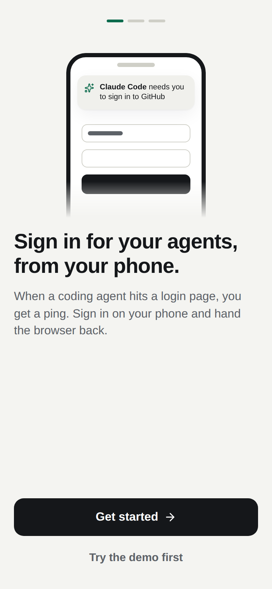
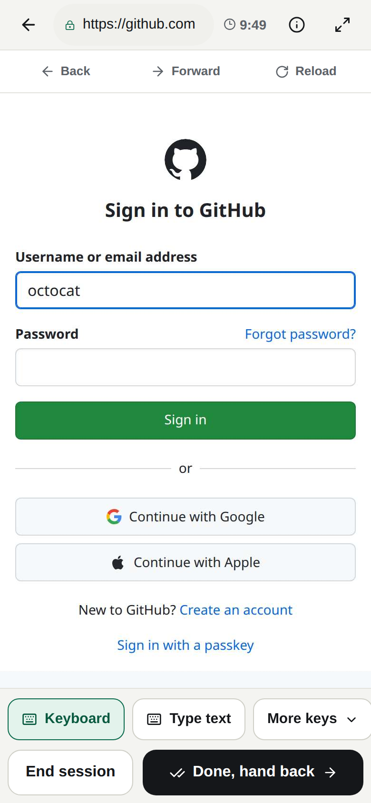
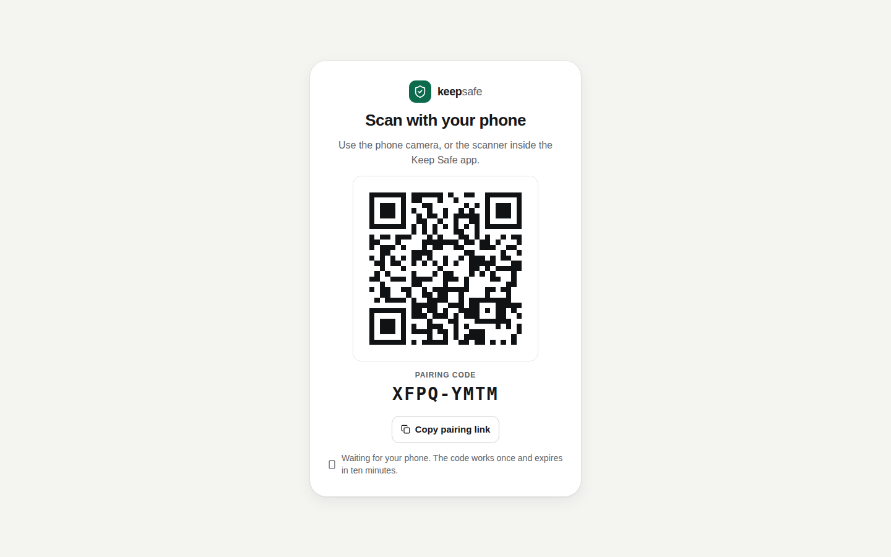

# Keep Safe

Your coding agent hit a login page. Sign in from your phone.

Keep Safe shows the agent's real browser on your phone. You approve the request, tap and type the sign-in yourself, then hand the browser back. The agent carries on in the same signed-in browser. Passwords and cookies stay on your computer.

**[Open Keep Safe](https://keep-safe-eight.vercel.app)** · [Connection guide](docs/connection.md) · [Phone app guide](docs/phone.md) · [Command reference](docs/cli.md)

Free and self-hosted. Early access.

<p>
  
  
  
</p>

## Set up in two minutes

You need Node.js 20.19 or newer on the computer your agents run on, and a phone.

### 1. On your computer

Paste this into any coding agent (Claude Code, Codex, Cursor, T3 Code and so on):

```text
Set up Keep Safe on this computer so I can approve website logins from my phone.

1. Run: npx -y github:Maseeek/keep-safe setup
   It needs Node.js 20 or newer and takes a minute or two the first time. It starts Keep Safe in the background, adds its MCP server to the agent CLIs it finds, and opens a page with a QR code in my browser.
2. I cannot see your terminal. Give me the "QR code page" link from its output as a clickable link, and tell me to scan the QR code on that page with my phone camera. One scan pairs my phone.
3. If your own MCP settings were not updated, add the JSON it printed under "Other MCP clients".
4. From now on, when a website needs me to sign in, call the keep-safe request_login tool, wait with wait_for_login, then continue in the same browser once I hand it back. Never ask me for passwords in chat.
```

Or run the command yourself:

```bash
npx -y github:Maseeek/keep-safe setup
```

`setup` does four things:

1. Installs the Chromium browser Keep Safe drives, if it is missing.
2. Starts Keep Safe in the background and opens a secure link your phone can reach from anywhere (see [Connecting](#connecting-your-phone)).
3. Adds the Keep Safe MCP server to Claude Code and Codex when their CLIs are installed, and prints the configuration for other MCP clients.
4. Opens a page with a one-time pairing QR code in your browser, and prints the same code in the terminal.

If an agent ran it for you, it gives you a **QR code page** link such as `http://127.0.0.1:4318/#qr=ABCD2345`. Open it on the computer.

For a permanent `keep-safe` command, install it globally instead: `npm install -g github:Maseeek/keep-safe`, then `keep-safe setup`.

### 2. On your phone

Scan the QR code with your camera. Keep Safe opens, pairs, and offers notifications. That is all: one scan, on Wi-Fi or mobile data, with nothing to install or type.

On an iPhone, add Keep Safe to your Home Screen first (Share, then Add to Home Screen), open it from there, and use **Scan QR code** inside the app. iOS keeps Home Screen apps separate from Safari, so pairing must happen in the installed app for notifications to work.

No camera? Choose **Cannot scan?** on the QR code page, copy the pairing link and open it on the phone.

### 3. Try it

Ask your agent to "use Keep Safe to sign in to GitHub", or practise with a harmless test page:

```bash
keep-safe rehearse     # or: npx -y github:Maseeek/keep-safe rehearse
```

## Connecting your phone

The browser runs on your computer, so your phone needs a way to reach it. By default Keep Safe opens a secure public link through a free Cloudflare tunnel. It needs no account, and the phone needs nothing installed. Pick another route with `--route`.

| Route | How to get it | Phone needs | Address stays the same | Notifications |
| --- | --- | --- | --- | --- |
| Secure public link | The default | Nothing | Until the computer restarts | Yes |
| Tailscale with HTTPS | `--route tailscale`, with HTTPS certificates on for your tailnet | Tailscale | Always | Yes |
| Tailscale | `--route tailscale` | Tailscale | Always | No |
| This computer only | `--route local` | Not reachable | Always | No |

The first run fetches Cloudflare's `cloudflared` program into `~/.keep-safe/bin` and checks it against its published checksum. The link's address is random and only answers a paired phone or a valid one-time code. Traffic passes through Cloudflare.

When the computer restarts, the link gets a new address. A phone with notifications on follows it by itself, because each notification carries the current address. Otherwise run `keep-safe pair` and scan once more. The phone keeps its key.

Tailscale keeps everything inside your own private network and its address never changes. Install it on the computer and the phone, sign in to both, and run `keep-safe up --route tailscale`.

The [connection guide](docs/connection.md) covers each route, pairing, and troubleshooting.

## How pairing works

`keep-safe pair` asks the local bridge for an eight-character code and shows it as a QR code, together with the computer's address. The code works once and expires after ten minutes. The phone trades it for its own key. Only a digest of that key is stored on your computer.

A paired phone stays paired while you use it and for 30 days after its last use. Revoke any phone from **Connect** in the app. The owner key never leaves your computer in this flow.

## Commands

```text
keep-safe setup      Install the browser, start Keep Safe, add it to your agents, show a pairing QR code
keep-safe pair       Show a new QR code to pair a phone
keep-safe up         Start Keep Safe in the background
keep-safe down       Stop it
keep-safe status     Show the phone address and paired phones
keep-safe mcp        Run the MCP server for an agent (starts Keep Safe if needed)
keep-safe doctor     Diagnose the connection
keep-safe rehearse   Practise a handoff with a harmless test page
```

Keys and state live in `~/.keep-safe`. See the [command reference](docs/cli.md) for options, key rotation and recovery.

## Use it from your agents

`setup` registers the MCP server for you where it can. To add it by hand:

```bash
claude mcp add --scope user keep-safe -- npx -y github:Maseeek/keep-safe mcp
codex mcp add keep-safe -- npx -y github:Maseeek/keep-safe mcp
```

For other MCP clients, use this configuration:

```json
{
  "mcpServers": {
    "keep-safe": { "command": "npx", "args": ["-y", "github:Maseeek/keep-safe", "mcp"] }
  }
}
```

The server offers three tools: `request_login`, `wait_for_login` and `get_login_request`. It starts the background bridge on demand, so it keeps working after a reboot. If no phone is paired, `request_login` tells the agent to ask you to run `keep-safe pair`.

Agents with their own Chromium browser pass its loopback debugging address as `cdp_url`. Otherwise Keep Safe opens a separate managed browser and gives the agent its address only after you hand it back. The [integration guide](docs/integrations.md) has the HTTP API and per-client notes.

## On the phone

- An inbox of requests with the agent, the website and the time left.
- A full-screen live view. The managed browser is sized to your phone's screen, so websites show their mobile layout.
- Tap to click, swipe to scroll. Tap a text field and type with your phone's keyboard. Characters go straight to the page and are not kept on the phone.
- A tool row for Tab, Enter, Backspace, more keys, pasted text, and a list of the page's fields and buttons.
- Website Back, Forward and Reload in managed browsers.
- The live website address, with a warning when it changes.
- **Done, hand back** returns the browser to the agent. **End session** declines.

Details are in the [phone app guide](docs/phone.md).

## Security at a glance

- Keep Safe does not store passwords, log input, record the screen or export cookies.
- Phones pair with single-use codes and hold their own revocable keys. Agents use a separate key and cannot approve requests or pair phones.
- The agent gets the browser back only after you choose **Done, hand back**. Before that, in-flight input is drained and remaining password fields are cleared.
- The managed browser reaches public websites only. Private and local network addresses are blocked.
- Chromium's debugging port stays on loopback.

[Architecture and security boundaries](docs/architecture.md) has the full account, including what Keep Safe does not protect against.

## Limits to know

- Your computer must be awake and running Keep Safe. The hosted app alone does not run a browser.
- A handoff lasts ten minutes by default and thirty at most. A managed browser closes at that deadline even after handback, so the agent must resume before then.
- Requests and activity are kept in memory and reset when Keep Safe restarts.
- Agents must pause while you are in control. Keep Safe cannot stop another program that already holds the browser's debugging address.
- Phone passkeys, biometrics and hardware security keys do not transfer into the remote browser. Some websites block automated browsers.
- On the default route the phone's address changes when the computer restarts. A phone without notifications needs one new scan after that.
- Notification delivery on a physical phone and the Tailscale HTTPS route have not been verified end to end by the maintainers yet. The secure public link, Tailscale without HTTPS, local use and Chromium phone emulation are tested.
- The page controls list is a helper, not a complete accessibility tree.

## Development

```bash
git clone https://github.com/Maseeek/keep-safe.git
cd keep-safe
npm ci
npx playwright install chromium
npm run dev          # frontend dev server on port 5173
npm run bridge       # foreground bridge using ./.keep-safe
npm run keep-safe -- status   # the CLI from this checkout
npm run typecheck
npm test             # builds the frontend, then runs every test
```

Tests cover request authorization, pairing codes, expiry, private-network restrictions, password clearing, MCP wire compatibility, and real Chromium sign-in and resume flows through the built phone app.

## Project records

- [Product brief](docs/alignment.md) and [product direction](docs/product.md)
- [Architecture and security](docs/architecture.md)
- [Agent integrations and HTTP protocol](docs/integrations.md)
- [Connection guide](docs/connection.md), [phone app guide](docs/phone.md), [command reference](docs/cli.md)
- [Validation plan](docs/validation.md), [delivery](docs/delivery.md), [owner contact](docs/contact.md)
- [Progress](docs/progress.md), [backlog](docs/backlog.md), [change history](CHANGELOG.md)

## License

[MIT](LICENSE)
