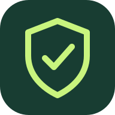

# Keep Safe

Help your agents sign in while you're away from your computer.

Keep Safe puts the agent's actual browser on your phone. Approve a request, interact with the website, complete the login, then hand control back. Your agent resumes in the same authenticated browser.

**[Open Keep Safe](https://keep-safe-eight.vercel.app)**

Early access. Private source. Free initial release. The hosted app opens in a labeled demo workspace until you pair your computer.

## What works

- Mobile-first inbox with request search, filters, expiry timers, approval, denial, and activity export.
- Live browser streaming with taps, scrolling, text entry, and keyboard controls.
- Live website origin with scheme and port, tap-to-expand inspection, and a warning when it changes.
- Separate owner and agent credentials, expiring control, and a bounded queue.
- Opt-in seven-day phone pairing with named devices and immediate revocation.
- Isolated managed Chromium or attachment to an existing agent Chromium browser through loopback CDP.
- MCP tools and an HTTP API so the integration is independent of a particular model.
- Web Push subscription support and an installable mobile web app.
- An explicitly labeled interactive demo that never asks for real credentials.

Passwords and browser inputs are not recorded. Managed browser cookies stay in memory on the developer's computer. Existing agent sessions remain owned by that browser. The hosted Vercel frontend does not receive website cookies.

## Start locally

Requirements: Node.js 20.19+ (Node 22 recommended), npm, and a computer that stays awake while your agents run.

```bash
git clone git@github.com:Maseeek/keep-safe.git
cd keep-safe
npm ci
npx playwright install chromium
npm run build:web
npm run bridge
```

The private repository requires GitHub access. On Linux, if Chromium reports missing system libraries, use `npx playwright install --with-deps chromium`.

The bridge listens at `http://127.0.0.1:4318` and prints a private owner pairing link. Open that link locally to pair the browser. Local credentials and Web Push keys are generated in ignored `.keep-safe/`, with owner-only file permissions.

Do not share the pairing link or expose the Chromium debugging port.

### Use your phone remotely

Your phone needs a reachable **HTTPS** bridge address. Use a trusted private network or an HTTPS tunnel to `http://127.0.0.1:4318`. The computer must remain awake. The bridge does not install or start a public tunnel automatically.

Start the bridge with the actual tunnel and hosted app origins:

```bash
npm run bridge -- \
  --public-url https://your-bridge.example \
  --app-url https://your-keep-safe-app.example
```

Open the printed pairing link on your phone. The app removes the token fragment and pairs the current tab. To keep access after closing the app, choose **Remember this phone for 7 days** when pairing, or use **Remember this phone** in Connections.

Remembering issues a separate device key. The original owner token is never saved in persistent browser storage. Remembered keys expire after seven days; revoke a device from Connections or choose **Forget this phone** to remove its local key and request revocation. Revocation also stops that device's live control and associated notifications. If the computer is offline, local forgetting succeeds but server revocation must be completed later from another paired device or the owner link.

For same-origin self-hosting, omit `--app-url`: the bridge serves the built frontend too. `npm run bridge -- --help` lists all supported options.

### Connect your agents

Generate the correct local configuration with `npm run --silent agent:config -- codex`, `claude`, or `antigravity`, then follow the [integration guide](docs/integrations.md). It exposes `request_login`, `get_login_request`, and `wait_for_login`. Agents using an existing Chromium browser pass its loopback `cdp_url`; otherwise Keep Safe opens a managed browser and returns its endpoint only after the owner completes the handoff.

Target clients include T3 Code, Claude, Codex, Antigravity, and other MCP-capable agents. This is a common protocol integration, not automatic access to every IDE's internal browser. Each native browser interface needs separate compatibility testing.

Chrome 136+ requires a non-default user data directory when launching with remote debugging switches. Use a dedicated agent browser profile or Playwright's bundled Chromium, not your personal daily profile. See the [Chrome debugging change](https://developer.chrome.com/blog/remote-debugging-port).

### Phone notifications

Pair the app, then choose **Enable notifications** in Settings. The bridge generates Web Push keys automatically. On iPhone, add the app to the Home Screen and open it there before enabling notifications, as required by [WebKit's Web Push support](https://webkit.org/blog/13878/web-push-for-web-apps-on-ios-and-ipados/).

The subscription API and notification routing are implemented. Lock-screen delivery on a physical iPhone or Android device has not yet been verified.

## Development and checks

```bash
npm run dev        # frontend development server, port 5173
npm run bridge     # separate local bridge
npm run typecheck
npm test           # builds the frontend, then runs tests
npm run build      # typecheck and production frontend build
```

Tests cover request authorization, state transitions, expiry, private-network restrictions, browser ownership, password-field clearing, MCP wire compatibility, and real Chromium login/resume flows. Built-app mobile tests exercise both the demo and a real login through the phone controls. CI runs on pushes and pull requests with read-only repository permissions.

Leaving a request on mobile stops its live stream and discards pending scroll input. Reopening resumes the same unexpired browser. Temporary connection and input-rate failures reconnect without deleting a valid pairing.

Phone controls use larger text and touch targets, with named remote keys and keyboard-accessible confirmations. Session status messages appear inside the mobile request so they do not cover the controls.

## Limits to know

- The bridge and agent computer must be running and reachable. The hosted dashboard alone does not run a browser.
- A handoff expires after ten minutes by default, with a maximum of thirty minutes. A managed browser closes at the original request deadline even after completion; the agent must resume before then.
- Requests and activity are currently in memory and reset when the bridge restarts.
- Agents must pause browser input while the owner is in control. Existing debugging clients cannot be forcibly stopped by Keep Safe.
- Phone passkeys, biometrics, hardware security keys, native password-manager integration, and every third-party login provider are not universally supported or verified.
- The remote webpage is streamed as an image. Its fields are not yet exposed as a structured interface to screen readers. The named toolbar controls do not provide full assistive navigation inside the website.
- There is no hosted multi-user account service or billing yet. Future team/managed-relay plans are in [product direction](docs/product.md).

## Project records

- [Agreed product brief and autonomy limits](docs/alignment.md)
- [Architecture, data handling, and security boundaries](docs/architecture.md)
- [Agent integrations and HTTP protocol](docs/integrations.md)
- [Delivery and recurring-work configuration](docs/delivery.md)
- [Owner contact status](docs/contact.md)
- [Progress](docs/progress.md), [backlog](docs/backlog.md), and [change history](CHANGELOG.md)

Autonomous development is authorized until **Saturday 24 October 2026 at 09:00 London time**, within **£0 additional spend**. Hourly continuation runs are configured and require this T3 environment to remain available.
